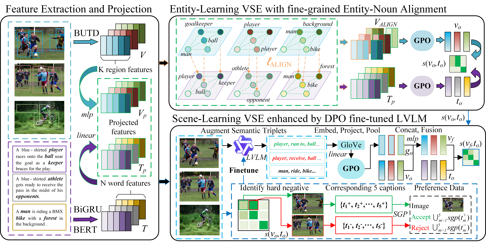

# USER

This work is currently submitted to ACM MM 2026, we built on top of the [VSE∞](https://github.com/woodfrog/vse_infty)


The DPO is performed based on [ms-swift](https://github.com/modelscope/ms-swift), version 3.8.0.
DPO script:
```bash
CUDA_VISIBLE_DEVICES=0,1,2,3 \
NPROC_PER_NODE=4 \
swift rlhf \
    --rlhf_type dpo \
    --model "path/to/qwen-2.5-vl-7b" \
    --model_type qwen2_5_vl \
    --torch_dtype bfloat16 \
    --train_type full \
    --freeze_vit true \
    --freeze_aligner true \
    --dataset "path/to/all_dpo.jsonl" \
    --output_dir "output" \
    --load_from_cache_file true \
    --split_dataset_ratio 0.0 \
    --num_train_epochs 10 \
    --per_device_train_batch_size 4 \
    --learning_rate 5e-5 \
    --warmup_ratio 0.05 \
    --rpo_alpha 0.1 \
    --eval_strategy no \
    --save_strategy epoch \
    --save_only_model true \
    --logging_steps 5 \
    --max_length 2048 \
    --dataloader_num_workers 8 \
    --dataset_num_proc 8 \
    --deepspeed zero3 \
```
